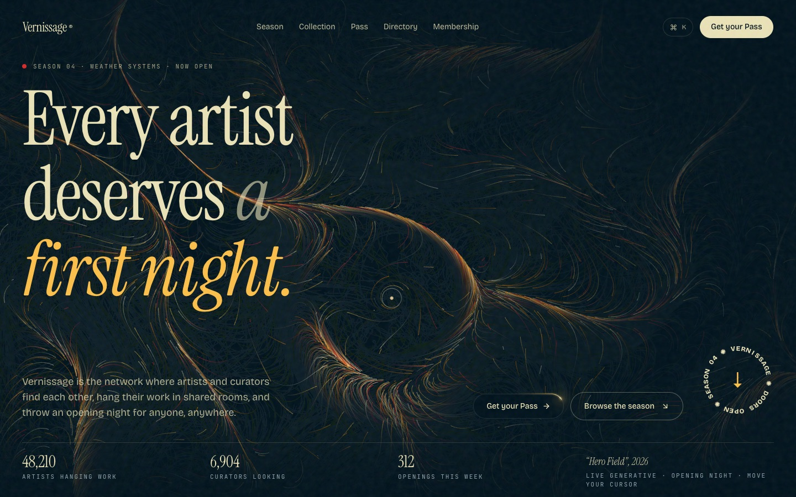
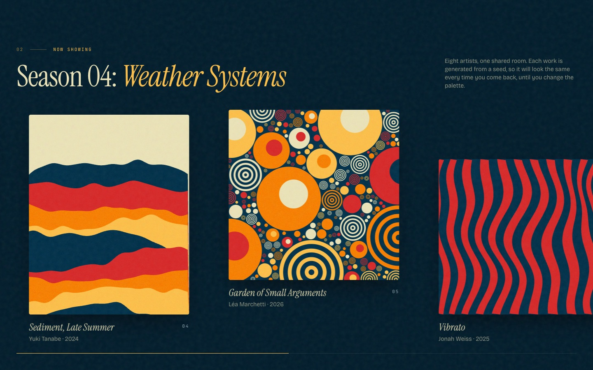
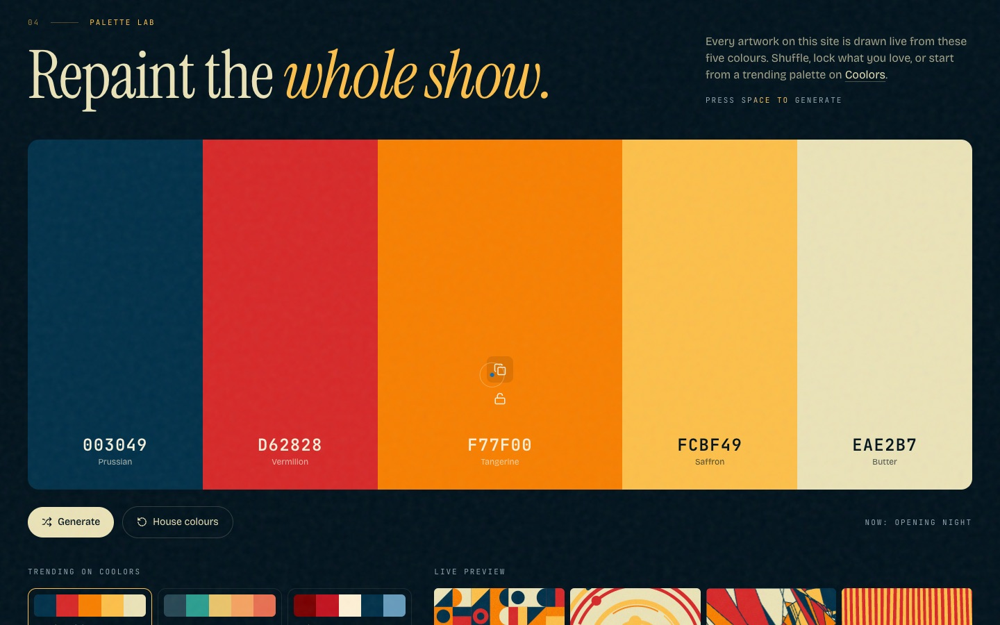
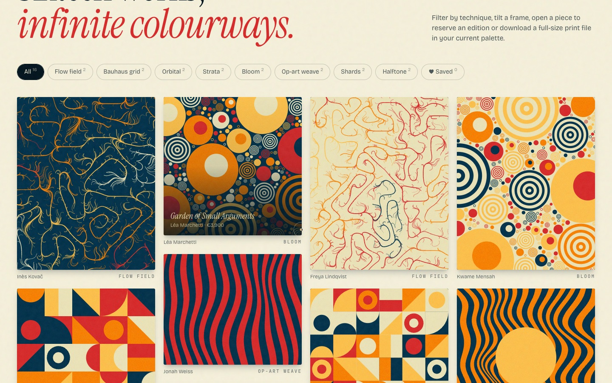
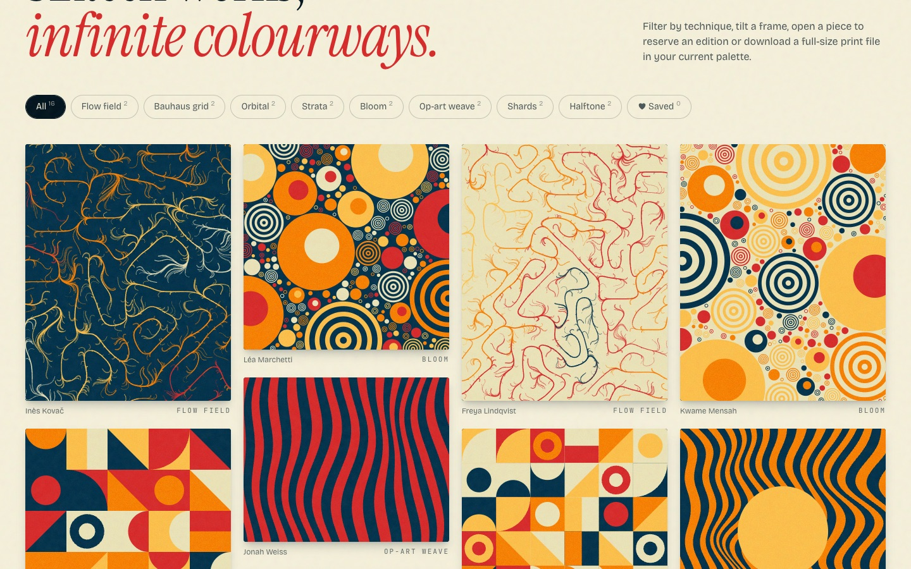
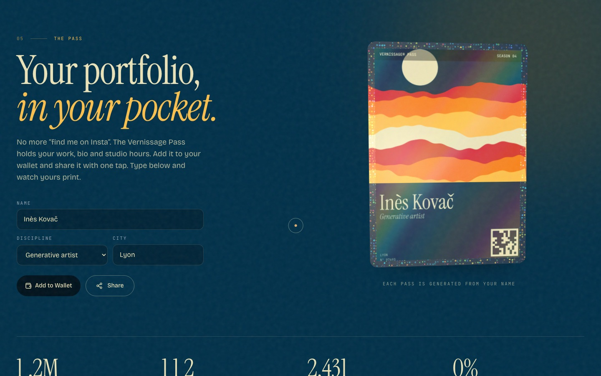
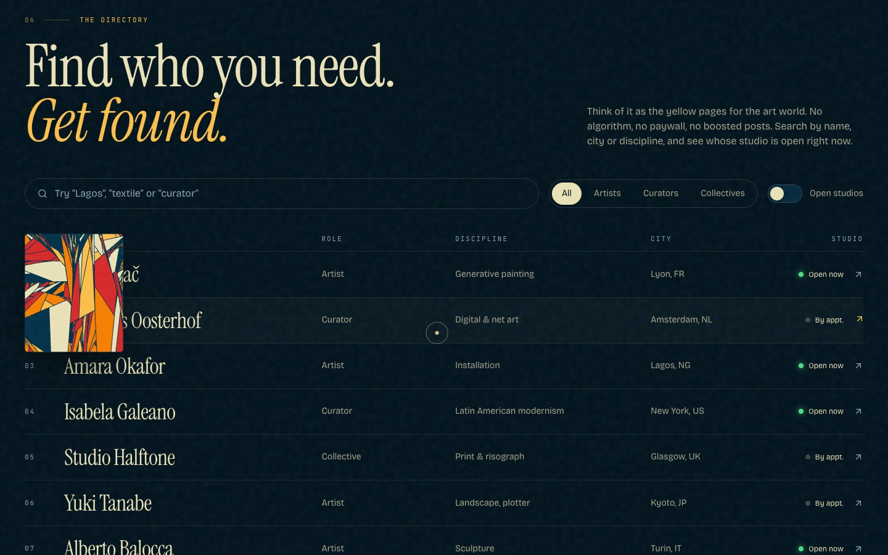
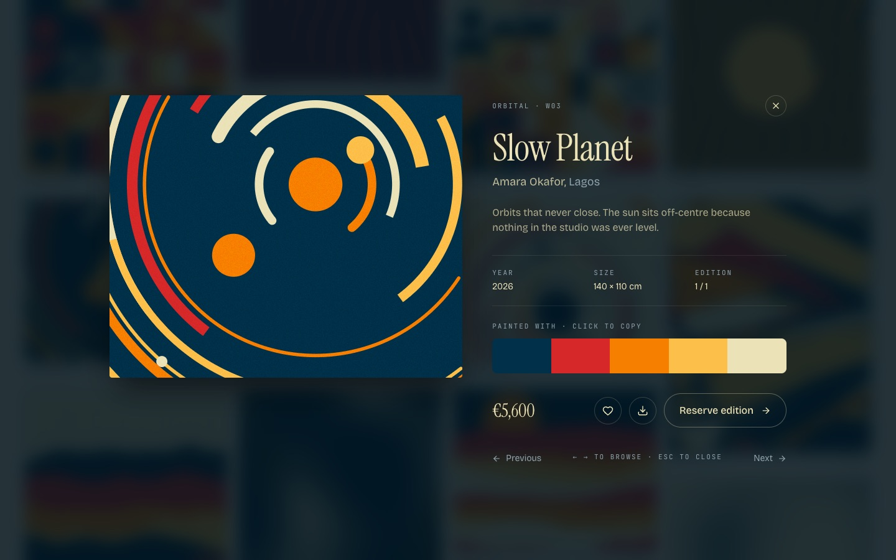
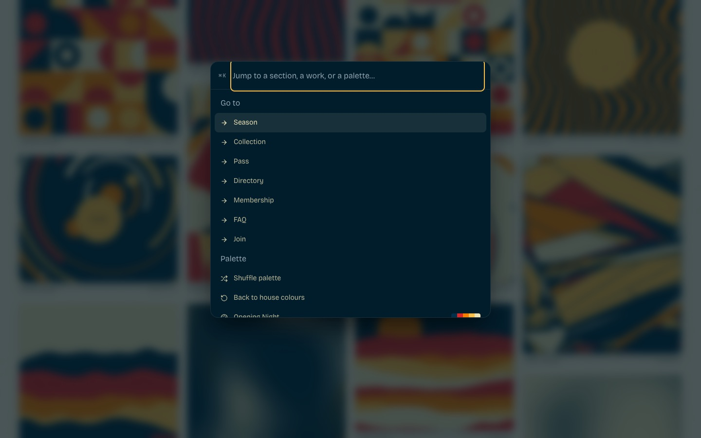
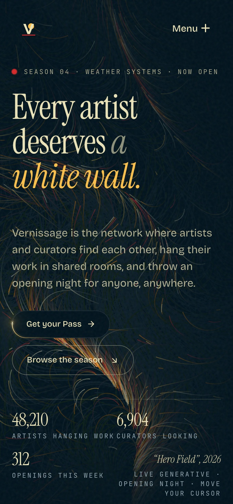

<div align="center">

# Vernissage

**The opening night for every artist.**

A demo website for a network where artists and curators find each other, hang their work in shared rooms and host openings online. Every artwork on the site is generated live in your browser from a seed and a five-colour palette, so the whole show repaints when you change it.

[**Live site → vernissage-gallery.vercel.app**](https://vernissage-gallery.vercel.app)



</div>

> Vernissage is the 2.0 rebuild of **FlowArt**. The old taupe/sage editorial theme, stock portraits and 50 unused UI components are gone. In their place are a new name, a new palette, generative artwork and about a dozen interactive sections. This is a design demo: every artist, artwork, price and quote is fictional.

## What's on the walls

| Section | What it does |
| --- | --- |
| **Hero** | A live, full-screen flow field (≈2,400 particles on a 3D simplex-noise wind). Your cursor stirs a vortex into it. Rotating headline, spinning circular badge, live stats. |
| **Manifesto** | Scroll-scrubbed text reveal, then four spotlight cards for the product pillars. |
| **Season 04** | A pinned room you scroll *sideways* through, with museum-style wall labels. Swipeable on mobile. |
| **Collection** | 16 works in a masonry wall with filter chips, 3D tilt on hover, and a ♥ Saved filter that persists. |
| **Artwork dialog** | Full details, click-to-copy palette swatches, save, reserve, and **download a full-size PNG print** rendered in your current palette. ← → to browse. |
| **Palette Lab** | A Coolors homage: press <kbd>Space</kbd> to generate, lock colours you like, copy hex codes, or start from 12 trending Coolors palettes. **Every artwork on the page repaints.** |
| **The Pass** | Type your name and city and a holographic membership card prints itself (art seeded from your name, QR-style code, member number). Tilt it with your cursor. |
| **Directory** | Live search across 20 fictional artists, curators and collectives, role tabs, an "open studios" switch, and an artwork preview that follows your cursor. |
| **Voices** | Three testimonial columns scrolling in opposite directions; hover to pause. |
| **Membership** | Monthly/yearly toggle with rolling price digits and a star-border featured tier. |
| **FAQ + Join + Footer** | Accordion, waitlist form with a paper-plane send animation, parallax art, live world clocks and a pressure-sensitive giant wordmark. |

Around the whole site there's also a preloader with palette curtains, a custom cursor that swells and labels what you're pointing at, click sparks, film grain, Lenis smooth scrolling, a **⌘K command menu** (jump to sections, apply palettes, open works, pause motion) and `prefers-reduced-motion` support.

<table>
<tr>
<td></td>
<td></td>
</tr>
<tr>
<td></td>
<td></td>
</tr>
<tr>
<td></td>
<td></td>
</tr>
<tr>
<td></td>
<td></td>
</tr>
</table>

<p align="center"></p>

## Design

**Palette: "Opening Night"**, from the [Coolors trending list](https://coolors.co/palettes/trending):

| Prussian | Vermilion | Tangerine | Saffron | Bone |
| --- | --- | --- | --- | --- |
| `#003049` | `#D62828` | `#F77F00` | `#FCBF49` | `#EAE2B7` |

The UI sits on a near-black ink (`#00121C`) derived from Prussian, with Saffron as the accent and alternating bone, saffron and vermilion sections for rhythm. The live palette is exposed as CSS variables (`--p0` … `--p4`), so decorative accents follow it too.

**Type.** *Instrument Serif* for display, *Bricolage Grotesque* for UI and body, *JetBrains Mono* for labels. All are self-hosted via Fontsource.

**Generative art.** [`src/art/engine.ts`](src/art/engine.ts) has eight seeded styles: flow field, Bauhaus grid, orbital, strata, bloom (circle packing), op-art weave, shards (recursive polygon splits) and halftone. Same seed + same palette = the same picture, which is what makes a work "collectable". Canvases render only near the viewport and repaint when their size or the palette changes.

### Sources and credits

| Resource | How it's used |
| --- | --- |
| [Coolors](https://coolors.co) | House palette and 12 trending presets; the Palette Lab mirrors its generate/lock/copy flow. |
| [React Bits](https://reactbits.dev) | 15 components installed through its shadcn registry, in [`src/components/reactbits`](src/components/reactbits): RotatingText, CircularText, StarBorder, CountUp, ScrollVelocity, ScrollReveal, SpotlightCard, Magnet, StaggeredMenu (mobile nav), HoloCard (the Pass), ShinyText, BlurText, DecryptedText, TextPressure (footer) and ClickSpark. Licensed MIT + Commons Clause ([notice](src/components/reactbits/LICENSE.md)). |
| [Animista](https://animista.net) | `tracking-in-expand`, `jello-horizontal`, `heartbeat`, `text-focus-in`, `flicker-in`, `wobble-hor-bottom` and `slide-in-blurred-bottom` keyframes in [`index.css`](src/index.css). |
| [Uiverse](https://uiverse.io) | Inspiration for the text-roll nav links, fill button, pill switch and paper-plane send button (rewritten in plain CSS). |
| [21st.dev](https://21st.dev/community/components) | Pattern references: scroll-linked horizontal gallery, spotlight cards, pricing toggle, hover-reveal directory. |
| [Awwwards](https://www.awwwards.com) | Direction from recent Sites of the Day: oversized editorial serif, preloader counter, custom labelled cursor, museum wall labels, generous negative space. |
| [Design Spells](https://www.designspells.com) | Small delights: palette-reactive everything, swatch jello on copy, heartbeat on save, live "open now" studio dots, art-preview cursor in the directory. |

## Tech stack

React 19 · TypeScript · Vite 8 · Tailwind CSS 4 · Motion · GSAP (via React Bits) · Lenis · cmdk · Sonner · simplex-noise · Lucide.

```text
src/
├── art/             # generative engine, <Artwork> canvas, live hero field, Pass card renderer
├── components/      # cursor, preloader, ⌘K menu, artwork dialog
│   └── reactbits/   # vendored React Bits components (+ their licence)
├── data/content.ts  # works, people, quotes, tiers, FAQ (all fictional)
├── lib/             # palettes + colour maths, smooth scroll, hooks
├── sections/        # one file per page section
└── state/           # palette + UI context (persisted in localStorage)
```

## Run it locally

```bash
git clone https://github.com/pronzzz/vernissage.git
cd vernissage
npm install
npm run dev
```

Then open http://localhost:5173. Other scripts:

```bash
npm run build     # type-check and build to dist/
npm run preview   # serve the production build
npm run lint
```

## Deploy

The repo deploys to Vercel from `main` (framework preset: Vite, output `dist`). [`vercel.json`](vercel.json) adds an SPA fallback, security headers and long-lived caching for hashed assets.

## Contributing

See [CONTRIBUTING.md](CONTRIBUTING.md).

## Licence

[MIT](LICENSE) for this project's code. Vendored React Bits components keep their own [MIT + Commons Clause licence](src/components/reactbits/LICENSE.md).
